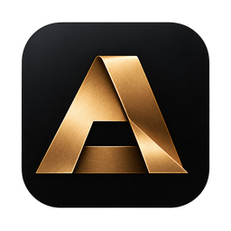
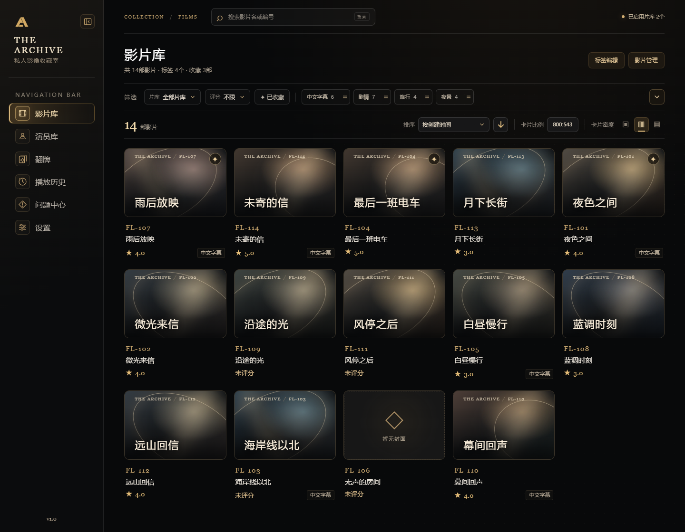
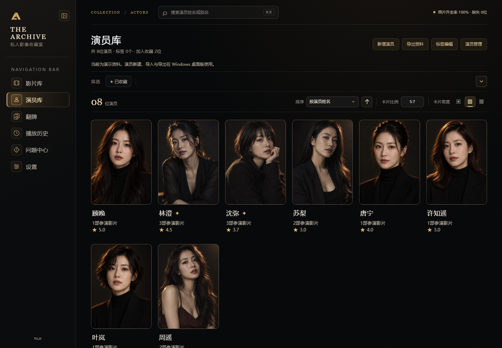

  

<h1 align="center">TheArchive</h1>

<strong>Your private film collection</strong>

Turn the films scattered across your drives into a collection of your own.

<a href="README.md">简体中文</a> · <strong>English</strong>

  
  
  
  

  <a href="#features">Features</a> ·
  <a href="#screenshots">Screenshots</a> ·
  <a href="#getting-started">Getting started</a> ·
  <a href="#data-and-privacy">Data and privacy</a> ·
  <a href="#local-development">Development</a> ·
  <a href="#fully-ai-developed">AI development</a>

TheArchive is a Windows desktop application for managing a local film collection. Scan your folders on demand, organize films with covers, tags, ratings and favorites, maintain actor profiles independently, and move between browsing, card draws and playback.

## Features

| 🎞️ Organize films | 👤 Manage actors |
| --- | --- |
| Scan local folders, manage multiple libraries and video versions, and filter by search, tags, rating or favorites. | Maintain names, aliases, photos and personal details; link film appearances and import or export actor.info files. |
| **🃏 Discover through card draws** | **▶️ Play your collection** |
| Draw up to eight different actors from your library each round and open their profiles after revealing the cards. | Use the built-in player or a custom external player, with seeking, speed, subtitles, audio tracks and a separate window. |
| **🗂️ Maintain your library** | **🌐 Translate on demand** |
| Adjust cover ratios and card density, back up application data, and check missing covers or duplicate film codes. | Translate film titles manually. The interface supports Simplified Chinese, Traditional Chinese, English and Japanese. |

## Screenshots

<table>
  <tr>
    <td width="50%">
Actor profiles and appearances
</td>
    <td width="50%">
Rediscover your collection
</td>
  </tr>
</table>

Screenshots show the Chinese interface with fictional demo records. They contain no personal library, private paths or account credentials. The browser demo presents the interface; real scanning and playback require the Windows desktop application.

## Getting started

### From folders to a library

1. **Add folders:** choose your film folders in Settings. You can add multiple libraries.
2. **Scan on demand:** read folder and video information to create film cards. Videos directly inside the same folder become versions or episodes of one film; subfolders are handled separately.
3. **Organize your collection:** edit titles and film codes, add tags, ratings and favorites, and select a preferred video version.
4. **Add actors:** create profiles manually or scan folders containing actor.info files, then manage their film appearances.
5. **Browse and play:** filter your films or rediscover them through actor profiles and card draws.

See the **[user guide](docs/USAGE.md)** for details. This repository currently provides source code; no downloadable installer has been published here yet.

### Example folder layout

You do not need to reorganize your entire drive into a fixed hierarchy. Category folders and individual film folders can be mixed:

~~~text
My films/
├─ Drama/
│  └─ [FL-101] Between the Lights/
│     ├─ poster.jpg
│     ├─ Main feature.mp4
│     └─ Director's cut.mkv
└─ [FL-102] A Letter at Dusk/
   ├─ poster.png
   └─ A Letter at Dusk.mp4
~~~

This produces two film cards. “Between the Lights” has two video versions. Covers use a poster image in the same folder; when a folder contains only one video, an image matching the video's filename can also be used. Supported image formats are JPG, JPEG, PNG, WebP and AVIF.

Actor profiles are managed separately. Scanning films does not automatically create actors from folder names. Each imported actor uses an actor.info file and an optional photo; see the [actor data format](docs/ACTOR_INFO.md) for an example.

## Data and privacy

| Content | Storage and handling |
| --- | --- |
| Films and media files | Originals are read-only. Editing application records or deleting a film entry does not rename, move or delete the media files. |
| Tags, ratings, favorites and appearances | Stored in the local application database and included in application backups. |
| Actor photos | The application stores the selected original's path and fingerprint and uses a display cache. Keep your original photos separately. |
| Translation keys | Stored in the current Windows user's system credential store, outside the database, logs and application backups. |
| Translation requests | Title text and required parameters are sent only after manual confirmation; your full library and media files are not sent. |
| Application backups | Include application records and non-secret settings, excluding media originals, original photos, image caches and translation keys. |

Run another scan when files change. Starting the application, switching pages or reconnecting a drive does not trigger an automatic scan. Back up your media and photos separately from application data.

## Before you use it

- **Browser demo and desktop application:** the browser uses fictional records for interface previews. Real library scanning, system credentials and local playback require the Windows application.
- **Platforms:** development and packaging currently target Windows x64. No macOS, Linux or mobile version is provided.
- **Translation services:** DeepL, Google Cloud Translation, Microsoft Azure Translator and Baidu Translate require your own service credentials and may incur charges. Startup and scanning do not make automatic API calls. Title translation currently targets Simplified Chinese, regardless of the interface language.
- **Playback history:** records successfully started playback, not completion or watch progress.
- **Validation:** the project is still being refined. See the [development guide](docs/DEVELOPMENT.md#当前验证边界) for the limits of testing on large real libraries, installation and upgrades, media formats and translation services.

## Local development

The frontend uses **React + TypeScript + Vite**. The desktop layer uses **Tauri + Rust + SQLite**.

### Browser demo

Install a Node.js version supported by Vite 7 and pnpm, then clone the repository and run:

~~~powershell
git clone https://github.com/Morskai/TheArchive.git
cd TheArchive
pnpm install --frozen-lockfile
pnpm dev
~~~

### Windows desktop development

You also need Rust 1.90+, MSVC C++ build tools, the Windows SDK and WebView2. Once the environment is ready, start the desktop application:

~~~powershell
pnpm desktop:dev
~~~

Packaging additionally requires NASM, the pinned player runtime and a complete Rust dependency cache. Use the standard installer build entry:

~~~powershell
pnpm desktop:build --bundles nsis
~~~

Desktop development uses the application's normal data location. Isolate test data before trying restore or reset operations. See the **[development guide](docs/DEVELOPMENT.md)** for preparation, testing and installer verification.

### Project layout

~~~text
src/             React pages, components, data interfaces and localization
src-tauri/src/   Rust desktop services, database, scanning, playback and translation
src-tauri/tests/ Backend integration tests
tests/           Frontend logic, browser checks and native interaction probes
scripts/         Player preparation and installer builds
docs/            User and developer guides, with screenshots
~~~

## Documentation

The detailed guides below are currently written in Chinese.

| Guide | Contents |
| --- | --- |
| [User guide](docs/USAGE.md) | Scanning, profiles, playback, translation and backups |
| [Development guide](docs/DEVELOPMENT.md) | Environment, builds, source map and validation limits |
| [Actor data format](docs/ACTOR_INFO.md) | actor.info fields, matching and export rules |
| [Translation guide](docs/TRANSLATION.md) | Services, credentials and translation memory |

## Fully AI-developed

**TheArchive is a fully AI-developed project.** Its application code, interaction and visual design, icons, images, tests and project documentation were all produced by **GPT-6.1 Sol**. The project owner provides requirements, feedback and acceptance reviews.

Use [Issues](https://github.com/Morskai/TheArchive/issues) to report a problem with its context and steps to reproduce.

## License and third-party components

The project's own source code, documentation and creative assets are available under the **[MIT License](LICENSE)**. The built-in player uses a replaceable LGPL libmpv runtime, whose license applies separately; see the [player notice](src-tauri/player-licenses/NOTICE.txt). Installer templates and test fixtures retain their license notices in their respective directories.
